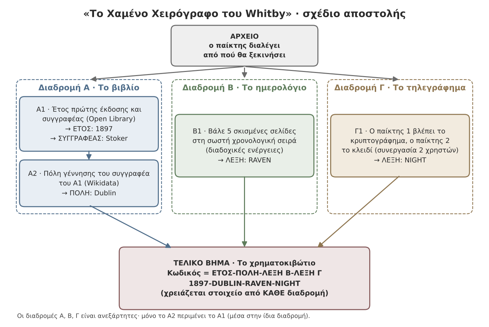

# Αποστολή: «Το Χαμένο Χειρόγραφο του Whitby»

## Θέμα

Σε ένα αρχείο βρίσκονται τρία ανεξάρτητα αντικείμενα: ένα βιβλίο χωρίς εξώφυλλο,
ένα σκισμένο ημερολόγιο και ένα κρυπτογραφημένο τηλεγράφημα.
Το καθένα οδηγεί σε μία διαδρομή. Στο τέλος, τα ευρήματα συνδυάζονται σε έναν
κωδικό που ανοίγει το χρηματοκιβώτιο με το χαμένο χειρόγραφο.

## Διαδρομές

Οι τρεις διαδρομές είναι ανεξάρτητες και παίζονται με όποια σειρά.

| Διαδρομή | Τι εξερευνά ο παίκτης | Στοιχείο που βγάζει |
|----------|-----------------------|---------------------|
| Α) Το βιβλίο | Βρίσκει ένα μυθιστόρημα και τον συγγραφέα του σε δημόσιες βάσεις | ΕΤΟΣ, ΣΥΓΓΡΑΦΕΑΣ και ΠΟΛΗ |
| Β) Το ημερολόγιο | Ταξινομεί σκισμένες σελίδες με χρονολογική σειρά | ΛΕΞΗ Β |
| Γ) Το τηλεγράφημα | Αποκρυπτογραφεί μήνυμα μαζί με άλλον παίκτη | ΛΕΞΗ Γ |

## Γρίφοι

| # | Διαδρομή | Ερώτηση | Σωστή απάντηση | Τι κερδίζει ο παίκτης | Τύπος |
|---|----------|---------|----------------|-----------------------|-------|
| A1 | Α | Στη ράχη του βιβλίου γράφει μόνο τον τίτλο «Dracula». Βρες στο Open Library το αρχικό μυθιστόρημα του 19ου αιώνα και πες το έτος πρώτης έκδοσης και τον συγγραφέα. | 1897 & Stoker | Στοιχεία ΕΤΟΣ και ΣΥΓΓΡΑΦΕΑΣ | Εξωτερικά δεδομένα (Open Library) |
| A2 | Α | Με το όνομα του συγγραφέα που βρήκες στο A1, βρες στο Wikidata σε ποια πόλη γεννήθηκε. | Dublin (δεκτό και Δουβλίνο) | Στοιχείο ΠΟΛΗ | Εξωτερικά δεδομένα: μεταφορά ευρήματος από το Open Library στο Wikidata |
| B1 | Β | Πέντε σκισμένες σελίδες έχουν ημερομηνία και από ένα γράμμα. Επίλεξέ τες με χρονολογική σειρά. | RAVEN | Στοιχείο ΛΕΞΗ Β | Διαδοχικά βήματα |
| Γ1 | Γ | Δύο διαφορετικοί παίκτες βρίσκουν από ένα κομμάτι (το κρυπτογραφημένο μήνυμα και το κλειδί) και μαζί βρίσκουν τη λέξη. | NIGHT | Στοιχείο ΛΕΞΗ Γ | Συνεργασία 2+ παικτών |
| F1 | Τελικό | Άνοιξε το χρηματοκιβώτιο με όλα τα ευρήματα. | 1897-DUBLIN-RAVEN-NIGHT | Ολοκλήρωση αποστολής | Συνδυασμός ευρημάτων |

## Λεπτομέρειες και επεξήγηση των γρίφων

**B1 - Οι σελίδες του ημερολογίου.** Ο παίκτης βλέπει πέντε σελίδες με αυτή τη σειρά. Ένα γράμμα είναι γραμμένο στο περιθώριο της καθεμιάς.

| Σελίδα | Ημερομηνία | Γράμμα |
|--------|------------|--------|
| 1 | 14 Αυγούστου 1890 | V |
| 2 | 28 Αυγούστου 1890 | N |
| 3 | 3 Αυγούστου 1890 | R |
| 4 | 21 Αυγούστου 1890 | E |
| 5 | 9 Αυγούστου 1890 | A |

Με χρονολογική σειρά οι σελίδες είναι 3, 5, 1, 4, 2, που δίνουν τα γράμματα
R, A, V, E, N. Ο παίκτης επιλέγει τις σελίδες μία-μία. Αν η σειρά είναι λάθος,
το παιχνίδι λέει μόνο «η σειρά δεν ταιριάζει» και ξεκινά από την αρχή, χωρίς να
αποκαλύπτει ποια σελίδα ήταν σωστή.

**Γ1 - Το τηλεγράφημα.** Ο 1ος παίκτης ανοίγει το τηλεγράφημα, που γράφει
`QLJKW`, και το καταχωρεί στο κοινό ημερολόγιο στοιχείων. Ένας άλλος παίκτης ως 2ος
της ίδιας ομάδας ανοίγει το σημείωμα κλειδί «κάθε γράμμα μετακινήθηκε 3 θέσεις
μπροστά» και το καταχωρεί κι αυτός. Μόλις υπάρχουν και τα δύο στοιχεία από δύο
διαφορετικούς χρήστες, η ομάδα μπορεί να δώσει την απάντηση. Δεν χρειάζεται
πραγματικός χρόνος. Αν ο ίδιος παίκτης καταχωρήσει και τα δύο, η απάντηση δεν
γίνεται δεκτή. Η αποκρυπτογράφηση: Q->N, L->I, J->G, K->H, W->T, δηλαδή NIGHT.

**F1 - Το χρηματοκιβώτιο.** Η πόρτα δείχνει τέσσερις υποδοχές χωρισμένες με
παύλα, με ετικέτες από πάνω: «Έτος», «Πόλη», «Ημερολόγιο», «Τηλεγράφημα».
Ο κωδικός δεν παίζει ρόλο αν γράφεται με κεφαλαία ή μικρά. Δεν ανοίγει αν
λείπει στοιχείο από οποιαδήποτε διαδρομή.

## Τελικό βήμα

Ο κωδικός σχηματίζεται από ένα στοιχείο κάθε διαδρομής: `ΕΤΟΣ-ΠΟΛΗ-ΛΕΞΗ Β-ΛΕΞΗ Γ`, δηλαδή `1897-DUBLIN-RAVEN-NIGHT`.
Ο παίκτης δεν μπορεί να το λύσει παίζοντας μόνο μία ή δύο διαδρομές.

## Σημειώσεις για την ομάδα

- Οι απαντήσεις των A1 και A2 θα αποθηκευτούν ως snapshot, ώστε να μην αλλάζουν.
- Το snapshot του A1 αναφέρεται σε συγκεκριμένο έργο (το πρωτότυπο του 1897), γιατί η αναζήτηση «dracula» επιστρέφει πολλά έργα.
- Πρέπει να επιβεβαιωθεί με πραγματική κλήση ότι το Open Library επιστρέφει 1897 και ότι το Wikidata δίνει Dublin ως τόπο γέννησης.
- Η αποστολή θα γραφτεί ως δεδομένα (π.χ. αρχείο JSON), ώστε μια δεύτερη αποστολή να προστίθεται χωρίς αλλαγή κώδικα.
- Οι γρίφοι B1 και Γ1 είναι εσωτερικοί και δεν χρειάζονται API.
- Στη διαδρομή Α, το A2 γίνεται πάντα μετά το A1.
