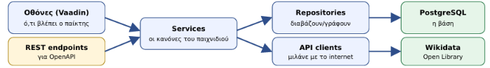

Οθόνες (Vaadin): Διεπαφή χρήστη για την αλληλεπίδραση των παικτών.

REST endpoints: Σημεία πρόσβασης για επικοινωνία με εξωτερικά συστήματα.

Services: Εδώ βρίσκονται όλοι οι κανόνες της λογικής του παιχνιδιού.

Repositories: Αναλαμβάνουν την αποθήκευση και ανάγνωση από τη βάση δεδομένων.

PostgreSQL: Η βάση που αποθηκεύει μόνιμα τα δεδομένα μας.

API clients: Επικοινωνούν με εξωτερικές πηγές (π.χ. Wikidata) για άντληση στοιχείων.